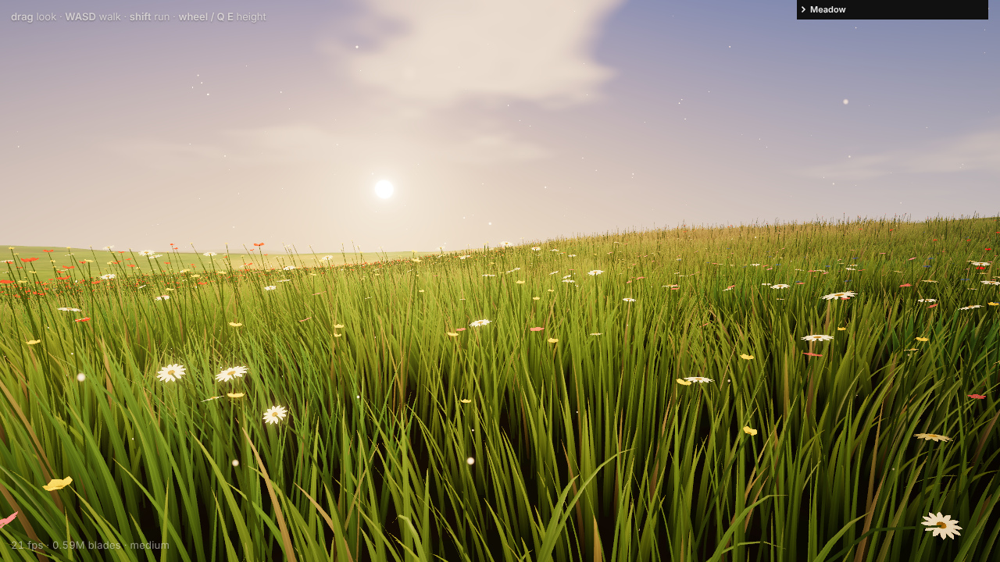
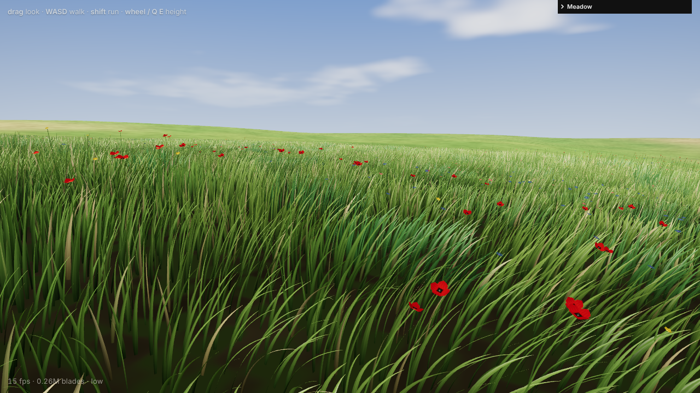

# Meadow

A procedural, GPU-driven meadow for the browser: over a million wind-swept grass
blades plus wildflowers, generated and culled every frame on the GPU with
**WebGPU compute shaders** and **indirect draws** (three.js r187, TSL).

Inspired by Ming Jyun Hung's write-up
[*False Earth: From WebGL Limits to a WebGPU-Driven World*](https://tympanus.net/codrops/2026/04/21/false-earth-from-webgl-limits-to-a-webgpu-driven-world/)
(Codrops) and its [open-source code](https://github.com/momentchan/false-earth).
The techniques are reimplemented here from scratch for an open meadow scene.

```bash
npm install
npm run dev        # http://localhost:5173
npm run build      # static site in dist/
```




<sub>Screenshots from a software (SwiftShader) renderer at the *medium/low* preset.</sub>

Needs a browser with WebGPU: Chrome / Edge 113+, Safari 26+, Firefox 141+ (Windows).

**Controls:** drag to look · WASD / arrows to walk · Shift to run (9 m/s) · wheel or Q/E to change height · M to toggle sound.
After 12 idle seconds the camera starts wandering on its own (auto tour).

**URL options:** `?q=low|medium|high|ultra` (disables adaptive quality),
`?hour=17.95`, `?grass=1.28`, `?clouds=0.35`, `?wind=0.55`, `?bloom=0`, `?tour=0`, `?sound=0`, `?nogui`.

## How the grass works

| Stage | What happens |
| --- | --- |
| **Slots** | An N×N grid of blade slots (up to 1664² ≈ 2.8M) is centred on the camera. It acts as a *toroidal window* over an infinite global lattice: slot `i` always holds the unique global cell ≡ `i (mod N)` inside the window. |
| **Lazy rebuild** | Each slot stores which global cell it holds. When the camera moves, only the rows and columns that wrap around rebuild their *static* data: jittered position, terrain height and normal, Voronoi clump, height, width, bend, yaw and dryness. Everything else is reused, so per-frame cost doesn't depend on how far you walk. |
| **Per-frame compute** | For every slot: radius test, sphere-vs-frustum test in clip space. Visible blades sample the travelling gust field, cloud shadow and walker push once (not per vertex), then `atomicAdd` themselves into one of three LOD lists. |
| **Indirect draw** | Each LOD (12 / 5 / 2 segments) is one `drawIndexedIndirect`. The instance count comes from the atomic counter, so the CPU never reads anything back. |
| **Vertex shader** | Each blade is a cubic Bézier spine. Wind pushes the control points, a phase that travels with the gusts makes waves roll across the field, and per-blade flutter is added on top. The curve is renormalised so blades keep their length, and is clamped above the local ground plane. With distance, blades turn partly toward the camera and widen, so they don't shimmer into sub-pixel slivers. |
| **Shading** | A custom foliage model: wrapped diffuse, sky/ground ambient, **translucency** (backlit blades glow), a waxy specular sheen, height AO, drifting cloud shadows and aerial perspective. The normal blends toward the terrain normal with distance, so the canopy behaves like a volume. |

Meadow-scale variation comes from low-frequency fields shared by every system:
tall vs short grass, dry straw patches, and flower drifts. Within those,
Voronoi **clumps** (tussocks) vary blade height, width, bend and colour, and
blades lean outward from each clump centre.

### Wildflowers
They use the same slot, compute, LOD and indirect pipeline with a sparser lattice.
Each flower is a single parametric mesh whose vertices are tagged as stem, petal
or centre. The vertex shader bends the stem like a blade and builds the head on
top, tilted toward the sun. Petal count, length, width and cupping depend on the
species: oxeye daisy, buttercup, poppy, cornflower or campion. Outlines (notches,
frills, rounded tips) are alpha-tested.

### The rest of the scene
- **Terrain:** an analytic value-noise height field, identical on CPU and GPU (the
  integer hash is bit-exact in JS), so the camera walks on exactly what is rendered.
  Its non-uniform grid follows the camera. Inside the grass radius it shows soil and
  thatch; outside it takes on the canopy's colour, texture and view-dependent
  darkening, so the edge of the grass is hard to spot.
- **Sky and fog:** both come from one radiance function, so the horizon has no
  seam. The sky adds a procedural cumulus layer and an HDR sun disk. A time-of-day
  palette drives all lighting.
- **Pollen:** a few thousand specks drift with the wind and sparkle only when
  backlit. They have no buffers; each position is a pure function of hash and time.
- **Post:** MSAA, bloom, ACES tone mapping, vignette.
- **Sound (Web Audio, fully synthesized, no audio files):**
  - *Music:* generative ambient in D major. Slow, lush pad chords (detuned
    sine/triangle voices through a slowly opening filter) and sparse soft
    mallet/bell notes drawn from the current chord, all in a long generated
    convolution reverb.
  - *Wind:* a low rumble, a moving whoosh and an airy grass-shimmer hiss. Their
    levels follow the exact gust field that bends the grass (a CPU mirror of the
    shader), sampled slightly upwind so you hear a gust roll in before it reaches you.
  - *Wildlife:* birds (whistle phrases, trills, two-note calls) by day with a dawn
    chorus, and crickets toward evening.
  - *You:* footsteps synced to the head bob (a soft soil thump, a "hush" of crushed
    grass and a cluster of crisp crunch grains), plus a continuous swish of legs
    through the grass that pulses with your stride and gets louder in tall grass
    and when running.
  - Sound starts on your first click or key press, as browsers require.

## Performance notes
- Storage buffers are packed (interleaved static data, one shared indirect-args
  buffer and one shared visible-index buffer per system), so each pass stays well
  under WebGPU's 8-storage-buffers-per-stage default limit.
- Draw order: near LODs first, then flowers, terrain and sky last. Covered terrain
  and sky pixels are rejected by early-z.
- Quality presets change blade count, grass radius, flower density, LOD distances
  and pixel-ratio cap. Without `?q=`, the app measures frame rate during the first
  seconds and steps quality down (or up) on its own.

## Files
```
src/main.js       renderer, post, GUI, adaptive quality, frame loop
src/grass.js      blade slots, compute pass, LOD routing, blade material
src/flowers.js    wildflower system
src/terrain.js    ground mesh + distant canopy shading
src/sky.js        sky dome, clouds, time-of-day palette
src/pollen.js     floating pollen
src/audio.js      procedural music, wind, wildlife, footsteps
src/controls.js   walk / look / auto-tour camera
src/gpu.js        storage + indirect-draw helpers
src/tsl/noise.js  bit-exact GPU/CPU hash + value noise
src/tsl/world.js  terrain, fields, wind, clouds, sky, fog, foliage lighting
```
